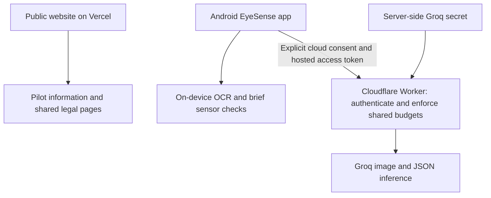

# Hosting, API keys and optional Supabase

## Recommended ten-user pilot architecture

The Vercel website is not a Flutter web version of the Android app. It does not access a camera, issue vision requests, distribute API keys or create participant accounts. Deploy it independently from the Worker.

For the pilot, **keep the existing Cloudflare inference proxy** rather than adding a second backend solely to hold an API key. The Worker already stores the operator's key as a server secret, validates requests, sanitizes errors and enforces shared minute/day/concurrency limits. A migration would introduce another deployment, authentication and privacy surface without proving Groq access.

| Value | Where it belongs | Where it must not go |
| --- | --- | --- |
| Operator Groq key | Cloudflare Worker secret `GROQ_API_KEY` | APK, static HTML, frontend build variables, logs, Git, chat |
| Hosted pilot token | Worker secret `DEMO_ACCESS_TOKEN` and operator-provisioned encrypted app storage | Static website or public APK compile-time define |
| Participant's direct-provider key | Their encrypted app storage, sent only to their explicitly selected provider | Vercel website, another provider or EyeSense Worker |
| Public Worker URL | App connection settings; optionally the non-secret build URL | It is not a credential and does not authorize inference |

Do not hand one operator-owned Groq/Mistral key to all ten participants. Hosted access currently uses a shared pilot token, **not individual identities or per-user revocation**. Restrict distribution, provision on supervised phones and rotate the token if exposed. Never log bearer tokens.

## Why Supabase will not fix the Groq 403

The original synthetic-image request and the explicitly authorized pilot recheck returned HTTP **403**. That is access denial, not the HTTP 429 used for a quota limit. The response does not identify an exact cause. Check the intended organization/project, key permissions, configured model access and account/region restrictions in Groq Console; contact Groq support if necessary. Do not use a proxy or region change to evade provider restrictions.

Moving the same request/key to Supabase, Vercel Functions or another server does not grant model access or guarantee success. A successful metadata query or `/health` response is not proof of image inference. Never promise that using a database makes AI requests reliable or free.

### Secure verification sequence

1. Check Groq Console account/project/model permissions and actual account limits. No specific free-tier allowance is guaranteed.
2. Store a valid operator key through Cloudflare's secret UI or interactive `npx wrangler secret put GROQ_API_KEY` from `worker/`. Do not include its value in commands, screenshots or support messages. Local `.dev.vars` is ignored and must not be copied to the website.
3. Deliberately deploy the Worker with its existing Durable Object binding and migration history after reviewing plan eligibility; see `worker/README.md`. No deployment has been performed by the local website build.
4. After resolving access, explicitly authorize **one** generated sample image/JSON test. The existing root tool `node tools/verify-groq.mjs --live` makes one potentially billable request without retry; the app's direct-provider sample test also requires consent and confirmation. These direct tests do not verify the deployed Worker route.
5. Separately verify authenticated hosted inference and one actual Android camera task using non-sensitive objects. Require valid parsed scene JSON, not just HTTP 200. Stop on 403; investigate rather than repeatedly retrying. Keep diagnostics to sanitized code/status, never raw provider bodies or images.
6. Keep shared pilot caps conservative (defaults: 6/minute, 2 concurrent, 100/day). Provider token/image/organization limits may throttle earlier. A timeout can still consume quota; do not automatically retry or turn on paid billing.

## When Supabase is worth adding

Supabase is a reasonable **optional next phase** for invite-only participant sign-in, individual access revocation, consent records and deliberately consented pilot feedback. It is not currently integrated, and no Supabase project/credentials were supplied.

A targeted design would retain the Worker and budget logic:

1. Supabase Auth issues short-lived participant sessions using an accessible, evaluated sign-in flow. Avoid making camera/OCR depend on a login or email task.
2. The Worker verifies each access token's signature, issuer, audience and expiry using the project's trusted signing keys, then checks an active pilot-membership record. Validate disabled memberships separately; a valid JWT alone does not provide immediate revocation. Reject invalid/expired users before inference.
3. Add explicit per-participant quotas alongside, not instead of, the existing global safeguards. Do not simply replace a shared bearer value with a user-supplied ID.
4. Apply Row Level Security to all client-readable/writable tables. Keep Supabase service-role/secret keys server-side; they bypass RLS. Public project/publishable configuration is not a private API key, but it still requires correct policies.
5. Store only the minimum needed records, with consent, deletion and retention rules. No camera-image, OCR-text or question-history storage by default. Adding identity/feedback collection requires new disclosures, reconsent and tests.

Alternatively, a Supabase Edge Function can own a provider secret and proxy inference, but that is a deliberate replacement backend: budget atomicity, request validation, cancellation, safety gates, error sanitization and tests must be ported. Never expose the Groq key through a client-readable table, RPC, response or Flutter/Vercel frontend variable. See [Supabase Edge Function secrets](https://supabase.com/docs/guides/functions/secrets).

Do not introduce Auth, a database, storage buckets and another inference proxy together just to prepare ten supervised stationary sessions. First demonstrate successful Groq access and the physical-phone accessibility pass. If independent participant access is required, individual authentication/revocation should be a separate scoped change before distribution.

## Mistral and Workers AI

Mistral is already an explicit direct-provider option and requires its own key; it has not been live-tested here. Free-mode inputs/outputs may train models unless opted out in the account; Free mode is not zero-data retention. It is not a hidden fallback for hosted Groq failures.

Cloudflare currently provides the proxy and budget store, **not Workers AI inference**. Adding Workers AI or hosted Mistral would require an explicitly selected backend, compatible image/JSON adapter, server-side credentials where needed, provider-specific limits, error handling and updated disclosures. Neither should silently receive photographs when Groq fails.

## Deployment status

The site is prepared for Vercel Git import with `site` as Root Directory, external source files included, `npm ci`, `npm run check` and `dist` output. See `site/README.md`. Local builds/tests do not publish a URL. No Vercel/Cloudflare/Supabase deployment, DNS change, successful live Groq response or physical accessibility certification is implied.
